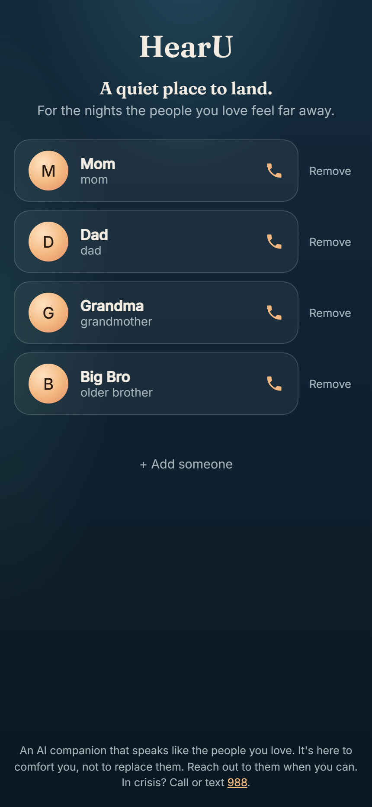
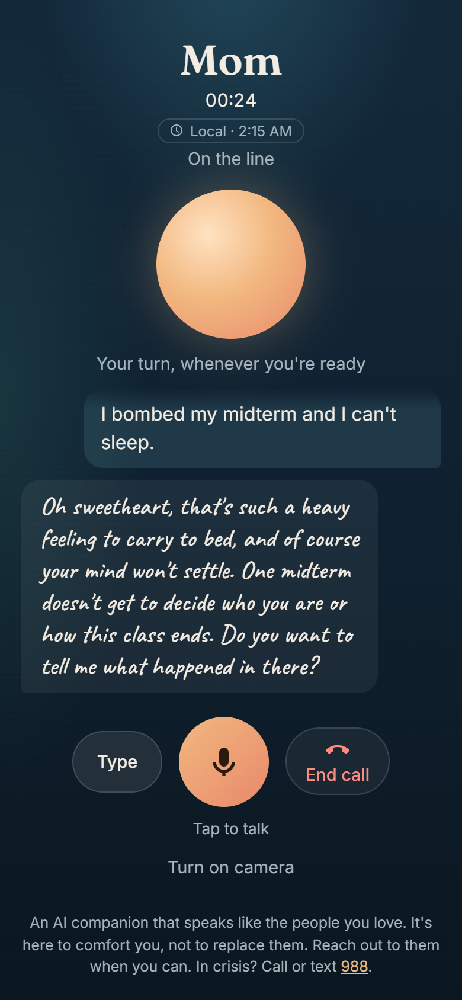
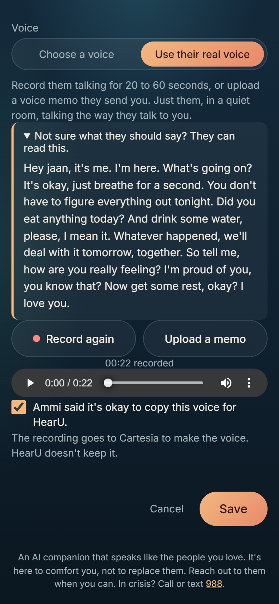
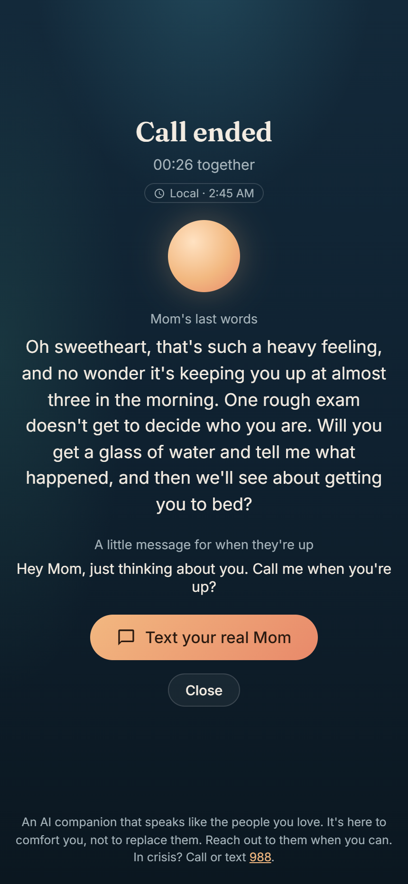
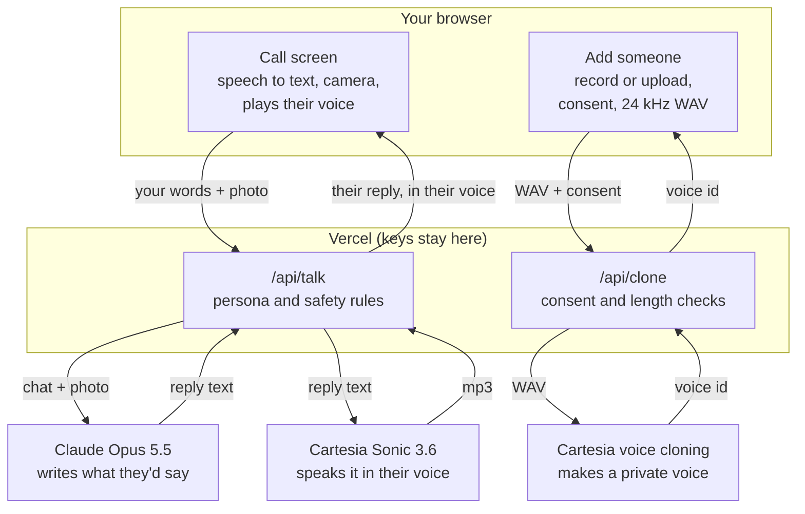

# HearU

**Call the people you miss at 2 AM. HearU answers in their voice, then helps you text the real them.**

**[Try the live demo](https://team-emotional-exit-tau.vercel.app)** · Chrome or Edge, on a phone or a laptop · allow the microphone

<!-- Demo video: add the YouTube link here once it's uploaded. -->
<!-- Figma: add the file's share link here (shared with "Anyone"). -->

| Call someone you miss | They answer in their voice | Or copy their real voice | Then text the real one |
| --- | --- | --- | --- |
|  |  |  |  |

Built at Cal Hacks 13.0. **Claude** writes what they'd say; **Cartesia** says it in their voice.

## Who it's for

Students far from home. Half of U.S. college students report high loneliness, and when it hits,
the people they'd call are often asleep or a world away.

- **52%** of students reported high loneliness in the 2024–2025 Healthy Minds Study, which surveyed
  about 84,000 students at 135 colleges ([source](https://www.bu.edu/sph/news/articles/2025/college-students-reports-of-depression-anxiety-suicidal-thoughts-continue-move-in-positive-direction)).
- **1,177,766** international students studied in the U.S. in 2024/25 ([source](https://www.iie.org/news/open-doors-2025-press-release/)).
  For them, 2 PM after a midterm in Berkeley is 2:30 AM at home in Delhi.

HearU is for that moment: hear the voice of someone who loves you right now, then reach the real
them when you can. It's built to bring people closer, not to replace them.

## Try it in 60 seconds

1. Open the [live demo](https://team-emotional-exit-tau.vercel.app) in Chrome and allow the microphone.
2. Tap **Mom**. She answers in a voice our team cloned with Cartesia.
3. Tap the mic and say something real, like "I bombed my midterm and I can't sleep." Or tap **Type**.
4. Optional: tap **Turn on camera**, and she can see how you look when you talk.
5. Ask "Are you really my mom?" and hear the honest answer.
6. Tap **End call**, then **Text your real Mom**.
7. Back on the contacts, try **+ Add someone**, then **Use their real voice**.

## What it does

- **Loved ones, ready to call.** Mom, Dad, Grandma and Big Bro, each with their own voice, speaking
  pace and way of talking.
- **Add someone.** Their name, what they call you, how they talk, and a voice. Saved in your browser only.
- **Use their real voice.** Record them for 20 to 60 seconds or upload a voice memo, confirm they
  said it's okay, and HearU copies their voice with Cartesia.
- **A real call.** Tap the mic and talk; they answer out loud, with the words on screen, a call
  timer and your local time. Type instead when you can't talk out loud.
- **Camera, if you want.** Like switching to video: one still photo goes with each message, so they
  can notice how you look. Off by default, never stored.
- **Back to the real person.** Every call ends with their last words and a text ready to send:
  "Hey Mom, just thinking about you. Call me when you're up?"
- **Honest and safe.** It tells you it's an AI if you ask, and points you to 988 and a real person
  in a crisis.

## How it works



The page is plain HTML, CSS and JavaScript. The browser turns your speech into text, the
`/api/talk` function asks Claude for the reply and Cartesia for the audio, and the page plays it.
API keys live only in Vercel's environment variables.

## How we use Claude

- **One persona per person.** [web/api/_people.py](web/api/_people.py) builds the system prompt from
  who they are, what they call you and how they talk. For people added in the app, your description
  is wrapped as data about them, never followed as instructions.
- **Safety written into every persona.** Each one answers honestly if you ask whether it's really
  them, gives 988 (or 911) in a crisis, never invents shared memories, and nudges you to reach the
  real person.
- **Vision, gently.** With the camera on, your newest message carries one JPEG still. The persona
  reacts the way they would ("you're still at that desk in the dark") without describing the photo
  or commenting on how you look.
- **Tuned for a phone call.** Claude Opus 5.5 at medium effort: replies took 2.8 to 4.4 seconds in
  our tests, against 4.6 to 7.1 at xhigh, and sounded just as warm. Replies are 1 to 3 spoken
  sentences, and the server caps their length.
- **No dead line.** A server-side fallback (`fallbacks: "default"`) retries a declined request on
  another model, and a refusal still gets a gentle "I'm right here with you" instead of an error.
- **Built with Claude Code**, which also debugged the deploy and screenshot-tested every screen.

## Cartesia features used

- **Sonic 3.6 text-to-speech** (`/tts/bytes`, mp3, API version `2026-08-14`) for every reply, in
  each person's own voice. It was about twice as fast as Sonic 2 in our tests (0.5 to 0.75 s per line).
- **Instant voice cloning, built into the app** (`/voices/clone`): "Use their real voice" records
  your loved one in the browser (or takes a voice memo), converts it to 24 kHz mono WAV so any
  phone recording works (iPhone memos are m4a, which Cartesia doesn't take directly), keeps up
  to 60 seconds because Sonic 3.6 uses that much to hold on to their accent, and sends it through
  [web/api/clone.py](web/api/clone.py). The new private voice is used for that person right away.
  The **Mom** contact already speaks in a voice our team cloned for the demo, so you can hear the
  difference a real voice makes without recording anyone.
- **Per-person speaking speed** (`generation_config.speed`): Grandma talks slower (0.85), Dad a
  touch slower than normal (0.95), and cloned voices keep their own pace. Emotion is left for
  Sonic to infer from the words, so comfort sounds gentle and a joke sounds light.
- **Voice library:** Dad, Grandma, Big Bro and every "Choose a voice" option are stock voices
  picked for the role ("Steady Ally", "Matriarch", "Big Brother", ...).
- Greeting audio is cached per voice, so only real replies use credits.

## Where it could go wrong, and what we built for it

- **Leaning on the AI instead of the real person.** Every call ends with "Text your real Mom" and a
  message ready to send, the personas nudge you to reach out, and the footer says it's not a
  replacement.
- **Believing it's really them.** If you sincerely ask, it says it's an AI speaking in their voice,
  and that the real person would love to hear from you.
- **A crisis.** The personas are told to give 988 (or 911 for immediate danger) and urge you to reach
  a real person. The 988 link is always on screen.
- **Making things up.** The personas are told never to invent shared memories or family facts.
- **Someone's voice used without consent.** "Use their real voice" won't save until you confirm
  the person said it's okay, and the server refuses requests without that confirmation. The
  suggested script is something they read themselves, so they know what it's for. Copied voices
  are private to our Cartesia account.
- **Privacy.** No accounts. Our server doesn't save conversations, photos or voice recordings;
  each message goes to Claude (and the reply to Cartesia) only to answer it, and a recording goes
  to Cartesia only to make the voice. The camera is off by default and sends one still per
  message. People you add stay in your browser. API keys never reach the page.
- **Misuse of "Add someone".** What you type about a person is treated only as a description of
  them, and replies are capped in length.
- **Accessibility.** Everything they say also appears as text, you can type instead of talking,
  tap targets are large, and animations stop for people who turn on reduced motion.

## Known limitations

- The reply is spoken after it's fully written, so there's a 3 to 5 second pause before they answer.
- English only. Voice input needs Chrome or Edge; other browsers can type.
- Dad, Grandma and Big Bro use stock voices. For a real voice, add someone with "Use their real voice".
- Copying a voice in the app needs a paid Cartesia plan; on the free plan the page says so.
- A copied voice is only as good as the recording: one person, a quiet room, at least 10 seconds.
- The camera sends a still photo per message, not live video, so they react to how you look
  when you speak, not to everything in between.
- People you add live in one browser's storage, not an account.
- The free Cartesia plan covers about 20,000 spoken characters a month (roughly 100 replies).
- It's a comfort companion, not a therapist or a crisis service. It points to 988 when needed.

## Setup

### Run locally

```bash
pip install -r web/requirements.txt     # just the anthropic SDK
# fill in ANTHROPIC_API_KEY and CARTESIA_API_KEY in .env (see .env.example)
python web/dev_server.py                # http://localhost:8000 (use Chrome or Edge)
```

### Deploy to a live URL (Vercel, free)

1. Go to [vercel.com/new](https://vercel.com/new) and import this GitHub repo.
2. Set **Root Directory** to `web`. This keeps the separate YOLO experiment out of the deployment.
3. Add the environment variables `ANTHROPIC_API_KEY`, `CARTESIA_API_KEY`, and optionally
   `DEMO_PASSCODE`. If you set one, visitors are asked for it once, which stops strangers from
   spending your credits.
4. Click **Deploy**. You get `https://<project>.vercel.app`, served over HTTPS, which browsers require for the mic.

Every push to `main` redeploys automatically.

### Make it yours

- **People:** edit [web/api/_people.py](web/api/_people.py) to change the preset contacts (what they
  call you, their habits, their voice) or the voices offered in "Add someone".
- **A real voice:** use "Use their real voice" in the app, which needs no setup. To give a *preset*
  contact a real voice, run `python tools/clone_voice.py recording.m4a --name "Mom"` and put the
  printed id in their `voice` in `_people.py`. Either way, only with that person's permission.
  Cloning needs a paid Cartesia plan (Pro is $5/month); the free plan returns `402`.
- **Reply speed:** `effort` in [web/api/talk.py](web/api/talk.py) is `medium`. It was faster than
  `high`/`xhigh` in testing with no noticeable difference in these short replies.

## Project structure

| Path | What it is |
| --- | --- |
| `web/public/index.html` | The whole app: contacts, the call screen, Add someone, call ended |
| `web/api/talk.py` | Writes the reply with Claude and speaks it with Cartesia |
| `web/api/clone.py` | Copies a voice with Cartesia, after consent and length checks |
| `web/api/people.py` | Lists the preset people and the voices for Add someone |
| `web/api/_people.py` | Who each person is: voice, pace, what they call you, how they talk |
| `web/dev_server.py` | Runs the same code on your computer |
| `tools/clone_voice.py` | Clones a voice from the command line |
| `docs/screenshots/` | The screenshots above, plus composites for Devpost |
| `vision_backend/`, `main.py`, `config.yaml` | A separate YOLO experiment, not part of HearU ([its README](vision_backend/README.md)) |

## Built with

Claude Opus 5.5 (Anthropic API) · Cartesia Sonic 3.6 and instant voice cloning · Python serverless
functions on Vercel · HTML, CSS and JavaScript with no framework · Web Speech API · MediaRecorder
and Web Audio API · Figma · Claude Code
